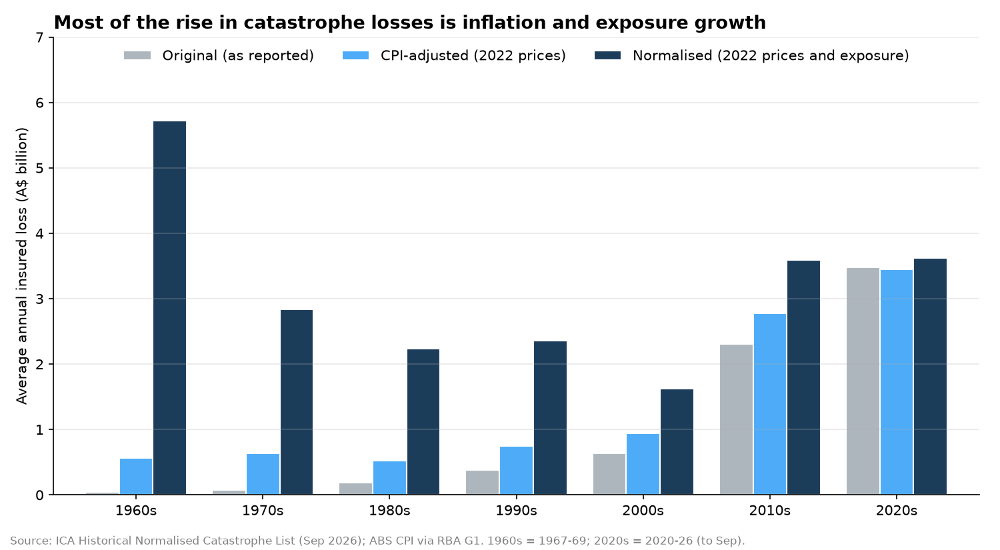
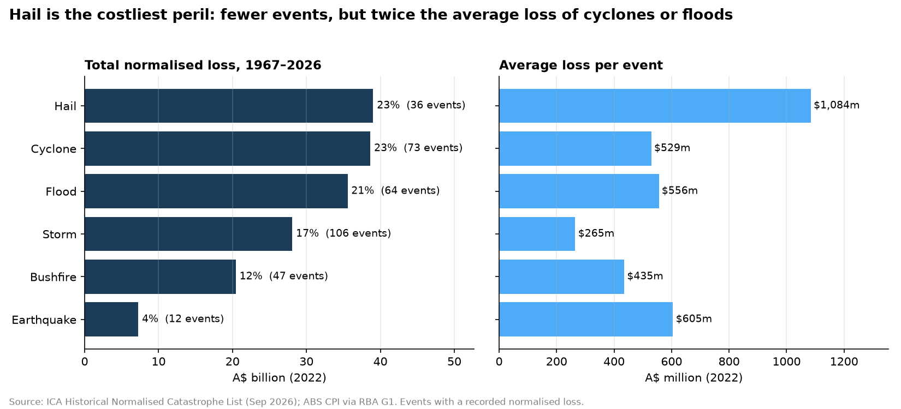
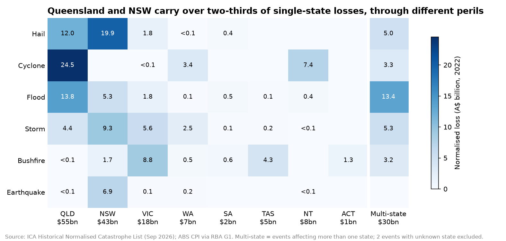
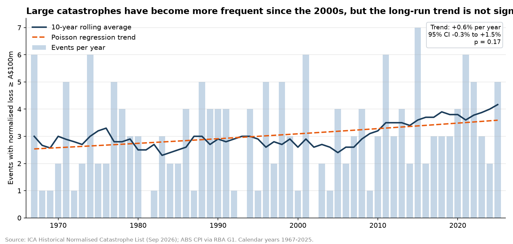
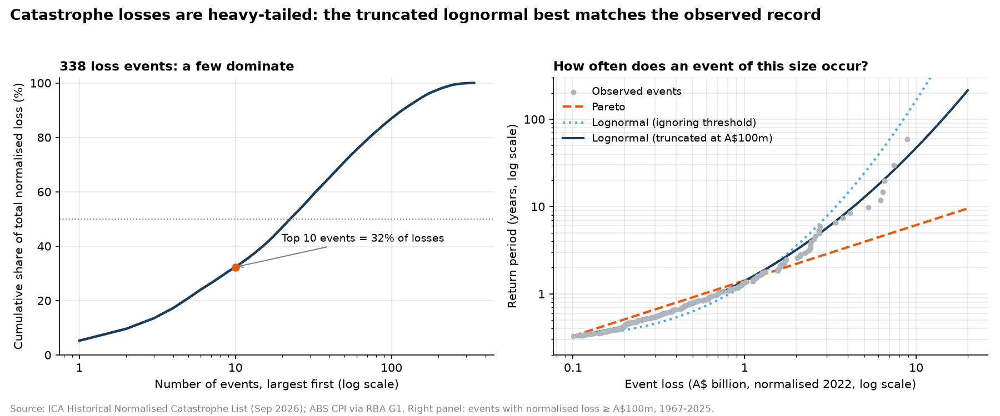
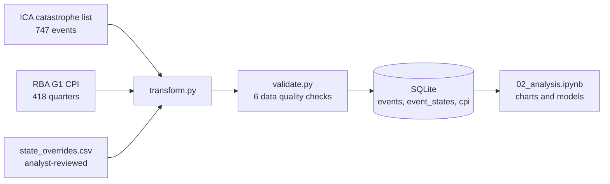

# Australian Natural Catastrophe Insurance Loss Analysis

How large are Australia's insured catastrophe losses, which perils and states drive
them, and are they getting worse? This project analyses **743 natural catastrophe
events from 1967 to 2026** in the Insurance Council of Australia (ICA) Historical
Catastrophe List, separating the effects of **inflation**, **exposure growth** and
**changing hazard**, and modelling event **frequency** and **severity** with
actuarial methods.

Built with **Python (pandas, statsmodels, SciPy) → SQLite → matplotlib**.
Companion project: [Australian General Insurance Performance Dashboard](https://github.com/duogvuu/apra-general-insurance-dashboard) (APRA data, Power BI).

## Key findings

1. **Most of the rise in reported losses is inflation and exposure growth.**
   Average annual reported losses grew about **50-fold** from the 1970s to the 2020s,
   but only about **27%** once losses are normalised to 2022 prices and exposure.
2. **Hail is Australia's costliest natural peril.** It caused **\$39.0bn** of
   normalised losses from just 36 events, about the same as cyclones from 73 events.
   One in three hail events exceeded \$1bn, driven by storms over Sydney and Brisbane.
3. **Queensland and NSW carry over two-thirds of single-state losses**, through
   different perils: cyclones and floods in Queensland, hail in NSW, bushfire in
   Victoria and Tasmania. Western Australia has many events (53) but only one
   above \$1bn.
4. **Large catastrophes have been more frequent since the late 2000s, but the
   long-run trend is not statistically significant.** A Poisson regression estimates
   **+0.6% per year** (95% CI −0.3% to +1.5%) for events above \$100m.
5. **Losses are heavy-tailed, and the choice of tail model matters.** The 10 largest
   events account for **32%** of all losses. The implied frequency of a \$5bn event
   ranges from 1-in-4 to 1-in-24 years across three models; a lognormal truncated
   at the data threshold best matches the observed record (about **1-in-13 years**).

All dollar figures are normalised to 2022 values unless stated otherwise.

## Analysis

### 1. Inflation and exposure growth explain most of the rise in losses



| Average annual loss | 1970s | 2020s | Change |
|---|---|---|---|
| Original (as reported) | \$0.07bn | \$3.48bn | ~50× |
| CPI-adjusted (2022 prices) | \$0.64bn | \$3.45bn | ~5× |
| Normalised (2022 prices and exposure) | \$2.84bn | \$3.62bn | +27% |

Comparing raw insured losses over time mostly measures growth in prices and in the
amount of insured property at risk. On a normalised basis, the 2010s and 2020s
(about \$3.6bn a year) are still around 75% above the 1980s–2000s average, which
Question 4 tests more formally. The 1960s figure covers only 1967–69, a period that
includes two of the costliest events on record.

### 2. Hail is the costliest peril



Hail, cyclones and floods together account for about two-thirds of normalised
losses. Hail ranks first because of severity, not frequency: the average hail event
costs \$1.1bn, roughly twice the average cyclone or flood, because major hailstorms
have hit densely populated capital cities. Most cyclones make landfall on sparsely
populated northern coasts.

### 3. Queensland and NSW dominate, through different perils



Losses from events that affected more than one state are shown separately, because
ICA does not split them between states; adding them to each affected state would
double count. Floods are the largest component of multi-state losses, likely because
large rain systems and river catchments such as the Murray–Darling cross state borders.

### 4. Is the frequency of large catastrophes increasing?



Counts of events above \$100m are modelled with a **Poisson regression** (a GLM with a
log link). The \$100m threshold was chosen in advance because small events are more
completely recorded in recent decades; other thresholds are a sensitivity check.

| Threshold | Events | Per year | Annual trend | 95% CI | p-value |
|---|---|---|---|---|---|
| \$100m (main) | 179 | 3.03 | +0.6% | −0.3% to +1.5% | 0.17 |
| \$250m | 117 | 1.98 | +1.1% | +0.0% to +2.2% | 0.05 |
| \$500m | 74 | 1.25 | +1.3% | −0.0% to +2.7% | 0.06 |
| \$1bn | 43 | 0.73 | +1.4% | −0.4% to +3.3% | 0.12 |

The direction is consistent across thresholds, but the evidence is weak over the
full record. The 10-year average is broadly flat until the late 2000s and then rises,
a shape a single log-linear trend cannot capture. Not statistically significant does
not mean no change: with 59 years of data, a real trend could easily go undetected.

### 5. Severity: a few events dominate



Return periods (years) implied by combining the observed frequency of large events
with three severity models:

| Event loss | Observed | Pareto | Lognormal (ignoring threshold) | Lognormal (truncated at \$100m) |
|---|---|---|---|---|
| \$1bn | 1.4 | 1.4 | 1.3 | 1.4 |
| \$2bn | 2.6 | 2.2 | 3.5 | 3.2 |
| \$5bn | 9.8 | 4.0 | 24.3 | 12.8 |
| \$10bn | not yet observed | 6.1 | 165.1 | 46.9 |

The models agree around \$1bn but diverge in the tail. The Pareto model overstates
extreme losses, while a lognormal fitted without accounting for the \$100m data
threshold understates them. For reinsurance and capital planning, the tail is what
matters, and the treatment of data thresholds can change the answer several-fold.

## Data

| Source | Description |
|---|---|
| [ICA Historical Normalised Catastrophe List](https://insurancecouncil.com.au/industry-members/data-hub/) (September 2026) | Catastrophe events since 1967 with original and normalised (2022) insured losses and claim counts |
| [RBA Statistical Table G1](https://www.rba.gov.au/statistics/tables/) | ABS All Groups Consumer Price Index, quarterly from 1922 (series GCPIAG) |

The ABS has moved to a monthly CPI, and its new tables start in 2024, so the long
quarterly CPI series is taken from RBA Table G1, which republishes ABS data.

**Loss measures used:**
- **Original loss:** insured loss as reported at the time.
- **CPI-adjusted loss:** original loss restated in 2022 prices using the CPI of the
  event's quarter (inflation only).
- **Normalised loss:** ICA's estimate of the loss if the event occurred in 2022, adjusting
  for inflation **and** changes in exposure (population, dwellings and their value).

## Approach



**Cleaning highlights:**
- **Man-made events excluded** (4 events, such as travel disruption from overseas
  conflicts), leaving 743 natural catastrophes.
- **State assignment.** ICA's State and Postcode columns are sparse and inconsistent
  (for example `FNQ`, `Vic`, `NSW and SEQ`), and 219 of 345 loss events had neither.
  States are derived from five sources in order of reliability: an analyst-reviewed
  override table (with a documented reason for each entry), postcode ranges, the
  standardised State column, place names in the event name or town, and place names
  in the description. This resolves 343 of 345 loss events.
- **Event IDs.** Declared events keep ICA's code; undeclared events receive a stable
  ID based on their start date.
- **Australian financial years** are recalculated from event dates (ICA's own labels
  use a different convention).
- **Many-to-many state relationships** are stored in a bridge table (`event_states`),
  used for counting events by state but not for summing losses, to avoid double counting.

**Data quality checks** (`src/validate.py`) stop the pipeline if any fail:
1. Event IDs are unique.
2. Every manual override refers to a real event and uses a valid state code.
3. No negative losses.
4. From 2022 (ICA's normalisation base year), normalised loss equals original loss.
5. Every loss event is matched to a CPI quarter.
6. No more than five loss events remain without a state.

## Limitations

- **Normalisation is a model.** ICA's normalisation may not capture every change in
  exposure, building standards or insurance take-up.
- **Recording completeness** has improved over time, so counts of small events are
  not comparable across decades; frequency analysis uses a \$100m threshold.
- **Short record for rare events.** Fewer than 60 years of data make tail and trend
  estimates uncertain; only six events exceed \$5bn.
- **Multi-state losses cannot be split** between states, so state totals understate
  exposure for states often hit by multi-state events.
- **Event-level view.** Severity models describe single events; annual aggregate
  losses (several large events in one season) would be higher.
- **Cause is not tested.** The data cannot separate natural climate variability
  (such as La Niña) from long-term climate change.

## Project structure

```
├── data/
│   ├── raw/                     # ICA and RBA source files (unchanged)
│   ├── reference/
│   │   └── state_overrides.csv  # analyst-reviewed state assignments, with reasons
│   └── processed/               # generated: CSV and SQLite database (git-ignored)
├── notebooks/
│   ├── 01_data_exploration.ipynb
│   └── 02_analysis.ipynb        # five analysis questions, charts and insights
├── reports/
│   └── figures/                 # charts used in this README
├── sql/
│   └── schema.sql
├── src/
│   ├── extract.py               # load ICA and CPI files
│   ├── locations.py             # derive states from postcodes, codes and place names
│   ├── transform.py             # clean, event IDs, financial years, CPI adjustment
│   ├── validate.py              # data quality checks
│   ├── load.py                  # build the SQLite database
│   └── pipeline.py              # run everything end to end
└── requirements.txt
```

## How to reproduce

Requirements: Python 3.11+.

```bash
git clone https://github.com/duogvuu/australian-catastrophe-loss-analysis.git
cd australian-catastrophe-loss-analysis
python -m venv .venv
.venv\Scripts\activate          # macOS/Linux: source .venv/bin/activate
pip install -r requirements.txt
python src/pipeline.py
```

Then open `notebooks/02_analysis.ipynb` and run all cells to recreate the charts.

## Sources and acknowledgements

- Insurance Council of Australia, *Historical Normalised Catastrophe List*, September 2026.
- Australian Bureau of Statistics, *Consumer Price Index, All Groups*, via Reserve Bank
  of Australia Statistical Table G1.

This is an independent analysis and is not endorsed by the ICA, ABS or RBA.

## Tech stack

Python (pandas, NumPy, SciPy, statsmodels, matplotlib) · SQLite · SQL ·
regular expressions · Poisson GLM · maximum likelihood estimation · Git

## Author

Quy Duong (Dave) Vu, Master of Computing (Computer Science), Curtin University, Perth.
